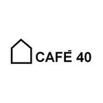

# Café 40 — design system de referência

Análise realizada em **23 de outubro de 2026**, com **SkillUI 1.3.4**, inspeção
visual das publicações públicas e medição de cores nas imagens do cliente.

Este documento orienta a landing page implementada neste projeto. A identidade observada, as
estimativas de imagens e as propostas de implementação estão identificadas
separadamente; não foi localizado um manual oficial da marca nas fontes analisadas.

## Fontes e método

| Fonte | Evidência local | Uso nesta análise |
| --- | --- | --- |
| [Instagram @cafe40.ni](https://www.instagram.com/cafe40.ni/) | [Captura do perfil](references/cafe40/instagram-profile-visible.png) e [metadados](references/cafe40/instagram-profile.json) | Logo, linguagem visual, fotografias e apresentação da cafeteria. |
| [Cardápio oficial](https://cardapio.takeat.app/cafe40), vinculado na bio | [Captura](references/cafe40/cardapio-official.png) e [inspeção](references/cafe40/cardapio-official.json) | Canal existente e referência técnica complementar. |
| Extração SkillUI do Instagram | [Relatório automático](research/skillui/instagram/cafe40-design/DESIGN.md) | Registro técnico dos estilos encontrados na plataforma. |
| Extração SkillUI do cardápio | [Relatório automático](research/skillui/cardapio/cafe40cardapio-design/DESIGN.md) | Registro técnico dos estilos do Takeat. |
| Publicações e avatar do cliente | [Origem das imagens](references/cafe40/brand-images.json) e [medições RGB](references/cafe40/color-observations.json) | Evidências visuais para a paleta e o tratamento fotográfico. |

**Como interpretar a extração:** a SkillUI lê HTML, CSS e estilos calculados.
No Instagram, esses estilos pertencem principalmente à interface da rede social;
no cardápio, grande parte pertence ao Takeat e às bibliotecas que ele utiliza.
As cores de botões das plataformas e as fontes Instagram Sans não comprovam a
identidade do Café 40. Os relatórios automáticos são evidências auxiliares; este
arquivo consolida a interpretação para o projeto.

## Identidade observada

- **Nome de apresentação:** Café 40; o letreiro da fachada e o avatar usam a
  composição em maiúsculas.
- **Contexto:** cafeteria no Centro de Nova Iguaçu. O perfil apresenta o lugar
  como uma pausa na rotina e associa a experiência a café, convivência e vinho.
- **Marca gráfica:** símbolo de uma casa em contorno, acompanhado de lettering
  sem serifa em peso forte. O avatar apresenta a versão preta sobre branco;
  a publicação de reservas mostra uma aplicação branca sobre fundo escuro.
- **Ambiente:** fachada alta de vidro, perfis metálicos escuros, luminárias de
  luz quente e materiais amadeirados. A fotografia da equipe mostra essa
  arquitetura com clareza.
- **Conteúdo visual:** produtos em primeiro plano, cenas do espaço e pessoas.
  Há variação entre peças promocionais; elas não demonstram uma única família
  tipográfica ou uma paleta institucional completa.



Referências principais: [fachada e equipe](originals/cafe40/post-cafe40-agosto.webp),
[produto](originals/cafe40/post-produtos.webp),
[aniversário](originals/cafe40/post-aviso-agosto.jpg),
[horários](originals/cafe40/post-horarios.webp) e
[reservas](originals/cafe40/post-reservas.webp).

## Paleta

Os valores medidos abaixo são **aproximações de arquivos rasterizados**, sujeitos
a compressão, iluminação e antialiasing. Não equivalem a códigos de um manual de
marca. O método agrupa pixels em intervalos de 16 por canal e calcula a média
de cada grupo; os resultados completos estão no JSON de medições.

| Cor | Valor observado | Evidência | Interpretação |
| --- | --- | --- | --- |
| Branco | `#FFFFFF` | Fundo dominante do avatar. | Base visual diretamente observada. |
| Preto | Próximo de `#030303`; há pixels `#000000` nas artes. | Marca no avatar e fundos das peças. | Base visual diretamente observada; normalizar para preto na implementação é uma decisão técnica. |
| Cobre/dourado | Próximo de `#C99568`, com variações como `#D69458`. | Letras da arte de aniversário. | Acento de campanha; uso na landing page depende de uma escolha de direção, não de confirmação institucional. |
| Bege acinzentado | Próximo de `#C7BEAC`. | Área clara da arte de horários. | Cor observada em uma peça; não assumir como fundo obrigatório do site. |
| Azul muito escuro | Próximo de `#020719`. | Fundo da arte de reservas. | Cor de campanha; não comprova um azul institucional. |

### Tokens usados na landing page

Direção aplicada, atualizada em **27 de outubro de 2026** a pedido do usuário:
inversão da interface original, com fundo preto e texto branco. As áreas antes
pretas, como a faixa de horários e o fechamento, passam a branco com texto preto.
As superfícies claras passam a um neutro escuro; o cobre permanece no foco e na
seleção. Os tons de chocolate e madeira continuam vindo das fotografias.

```css
:root {
  color-scheme: dark;
  /* Inversão da base monocromática solicitada para a interface. */
  --color-background: #000000;
  --color-ink: #ffffff;
  --color-inverse: #000000;

  /* Neutros propostos para a interface. */
  --color-surface: #0b0b0d;
  --color-muted: #aaaaaa;

  /* Aproximação de uma campanha; acento opcional. */
  --color-accent: #c99568;
  --color-on-accent: #000000;
  --color-focus: var(--color-accent);
  --color-focus-on-inverse: #805a39;

  --color-action: var(--color-ink);
  --color-on-action: var(--color-inverse);
}
```

Texto principal branco sobre preto; ações principais com fundo branco e texto
preto. Nas áreas brancas, usar texto preto e ação preta com texto branco. O foco
usa cobre no fundo escuro e uma variante mais escura nas áreas brancas. A seleção
de texto combina cobre e preto. Botões mantêm o contraste ao passar o ponteiro,
com resposta de movimento discreta e alternativa para movimento reduzido.

## Tipografia

**Observado:** lettering forte, sem serifa, no logo e no letreiro. As artes
misturam fontes condensadas, serifadas e manuscritas. Não há evidência suficiente
para identificar a família original do logotipo ou declarar uma fonte oficial.

**Cardápio:** a inspeção do título visível encontrou `Poppins, sans-serif`, em
24px. A SkillUI também encontrou Raleway no CSS, o que comprova sua presença no
código da plataforma, sem comprovar seu uso como fonte institucional da cafeteria.

**Escolha aplicada no site:** Poppins como uma única família inicial, pela
continuidade com o canal existente. Usar o arquivo original do logo como marca,
sem tentar reproduzi-lo digitando o nome em Poppins.

| Papel | Proposta desktop | Proposta mobile | Peso |
| --- | --- | --- | --- |
| Título principal | 64–88px, conforme o texto | 36–44px | 600–700 |
| Títulos de seção | 36–48px | 28–32px | 600 |
| Texto | 18px | 16–18px | 400 |
| Controles e informações auxiliares | 16px | 16px | 500–600 |

Essas medidas são propostas, não valores extraídos da marca. Manter títulos
curtos, entrelinha de 1–1,1 nos títulos e de 1,5–1,6 no texto. Disponibilizar a
fonte localmente ao implementar a página, com os arquivos e a licença adequados.

## Fotografia e direção visual

- Dar destaque à arquitetura real: vidro, estrutura preta e iluminação quente.
- Fotografar ou selecionar produtos reais em planos próximos, preservando cores
  e texturas. A publicação de bolo mostra um exemplo desse tratamento.
- Usar pessoas e cenas do local para apresentar a experiência da cafeteria.
- Preservar o clima luminoso das imagens; evitar aplicar a mesma tonalização
  artificial sobre todos os produtos.
- Tratar cobre e luz quente como apoio à base monocromática, caso façam parte
  da direção escolhida para a página.

As imagens em `brand/`, `originals/` e `references/` documentam a análise. O avatar tem apenas
**150 × 150px**; ele não substitui um arquivo de logo em alta resolução ou vetor.
As miniaturas das publicações servem como referências e precisam ser avaliadas
antes de ocupar grandes áreas da landing page. As evidências locais não
estabelecem licença para reutilizar fotografias de colaboradores ou visitantes.

## Composição e componentes propostos

As fontes consultadas não permitem extrair um grid de site próprio do cliente.
As decisões abaixo orientaram a implementação com a skill Taste e a referência
Grain escolhida pelo usuário; não são regras de um manual oficial da marca.

| Elemento | Diretriz proposta |
| --- | --- |
| Estrutura | Margens laterais iguais; 20–24px no celular e 32px no desktop, com composições amplas para a fotografia. |
| Espaçamento | Escala de 8, 16, 24, 32, 48, 64, 96 e 128px; separar seções mais do que os elementos internos. |
| Navegação | Logo, poucos links e uma ação com destino real. |
| Botões | Preenchimento branco e texto preto na base escura; preto e texto branco nas áreas claras. Área de toque mínima de 44px e foco visível. |
| Imagens | Cantos retos como proposta inicial, coerente com as linhas da arquitetura. |
| Conteúdo | Priorizar fotografia e texto; definir a composição de cada seção a partir do conteúdo disponível. |
| Movimento | Interações discretas, sem esconder conteúdo essencial e respeitando a preferência por movimento reduzido. |

## Aplicação da marca e conteúdo

Preservar a proporção do símbolo e do lettering. O arquivo original do avatar
continua preservado com fundo branco. Na interface, a inversão solicitada é
aplicada apenas às imagens do logo por CSS (`filter: invert(1)`), produzindo marca
clara sobre preto sem modificar o arquivo de origem nem as fotografias. Esse
tratamento é uma decisão desta versão, não uma versão oficial fornecida pela
marca. Adotar inicialmente uma área livre de aproximadamente uma altura de letra
ao redor do conjunto — regra proposta, sujeita ao manual original.

Na escrita, preferir frases curtas, convites diretos e referências concretas ao
espaço e aos produtos. Nome, horários, preços, cardápio e contatos devem ser
conferidos nos canais oficiais quando o conteúdo da página for implementado.
As imagens de promoções antigas não devem definir informações operacionais atuais.

## O que permanece sem confirmação

- Arquivo vetorial do logo, família original e regras oficiais de aplicação.
- Códigos institucionais de cor e papel permanente do cobre, bege ou azul escuro.
- Validação pelo cliente da tipografia e do conteúdo aplicados nesta versão.

O documento já oferece uma base visual utilizável. As propostas acima podem ser
ajustadas se o cliente fornecer um manual de marca ou definir outra direção.

## Landing page aplicada: Grain

Referência estrutural: [Grain no Landingfolio](https://www.landingfolio.com/inspiration/post/grain),
na seção **Full page / Landing Page / Desktop**. A captura completa, de
1440 × 8834px, está em
[assets/references/grain](references/grain/full-page-landing-desktop.png).
A [origem da captura](references/grain/source.json) registra o escopo exato.

O design system do Café 40 foi aplicado a essa composição: Poppins local, fundo
preto, texto branco, superfícies escuras, botões brancos e fechamento branco com
ação preta. A faixa de horários também fica branca. O cobre continua reservado
ao foco e à seleção; o verde da Grain não foi adotado.

| Estrutura da referência | Seção no Café 40 | Componente Next.js |
| --- | --- | --- |
| Navegação e anúncio | Marca, links, contato e informação de visita. | `app/components/header.tsx` |
| Hero em duas colunas | Título, cardápio e composição com fachada e bebida. | `app/page.tsx` |
| Manifesto e faixa de marcas | Apresentação e experiências: café, cozinha, encontros e coworking. | `app/page.tsx` |
| Quatro blocos alternados | Bebidas, doces, espaço e reservas. | `app/page.tsx` |
| Quatro depoimentos alternados | Quatro momentos editoriais com imagens reais; sem avaliações inventadas. | `app/page.tsx` |
| Demonstração ampla | Seleção de visita com foto, descrição e conversa por WhatsApp. | `app/components/visit-planner.tsx` |
| Três chamadas fotográficas | Bebidas, acompanhamentos e convivência. | `app/page.tsx` |
| CTA escuro | Cardápio, horário, endereço e mapa em fundo branco após a inversão. | `app/page.tsx` |
| Rodapé em colunas | Navegação e contatos reais. | `app/components/footer.tsx` |

Os componentes ficam em `app/`, após a migração para Next.js e TypeScript em
05/11/2026. No celular, as composições passam para
uma coluna com texto antes da imagem, e o menu passa a ser acionável. Conteúdo,
navegação e envio da escolha ao contato funcionam sem JavaScript.

A interação própria da página é **Como vai ser sua pausa?**: o visitante escolhe
café, coworking ou encontro; a página atualiza a imagem e a explicação e prepara
a conversa correspondente. Disponibilidade é tratada com a equipe.

A direção foi definida pela referência do usuário; o sorteio de outro layout da
Taste foi dispensado para preservar a composição pedida. A Taste foi utilizada
na hierarquia, adaptação, movimento e revisão em navegador.

Arquivos de implementação:

- [Tokens CSS](../app/styles/tokens.css).
- [Fundamentos e controles](../app/styles/base.css).
- [Composição e responsivo](../app/styles/landing.css).
- [Conteúdo](../app/content.ts).
- [Mapa detalhado da referência](../docs/reference-map.md).
- [Organização de pastas](../docs/project-structure.md).
- [Créditos e limites das imagens](../docs/attributions.md).

O avatar fica em `assets/brand/` e as imagens de publicações sem tratamento em
`assets/originals/cafe40/`. Capturas e metadados ficam em `assets/references/`;
as extrações e coletas, em `assets/research/`. Apenas arquivos necessários
ao site ficam em `public/static/`.

## Reprodução da extração

Na raiz do projeto, com as dependências instaladas:

```powershell
npm.cmd run skillui -- --url https://www.instagram.com/cafe40.ni/ --out ./assets/research/skillui/instagram --name Cafe40 --no-skill
npm.cmd run skillui -- --url https://cardapio.takeat.app/cafe40 --out ./assets/research/skillui/cardapio --name Cafe40Cardapio --no-skill
```

As duas extrações concluíram e geraram relatórios e capturas. A curadoria deste
arquivo acrescenta a leitura das imagens e distingue os estilos das plataformas
das evidências da marca. Uma nova execução dos comandos atualiza os relatórios
automáticos; a consolidação em `assets/design.md` exige revisão das novas evidências.
