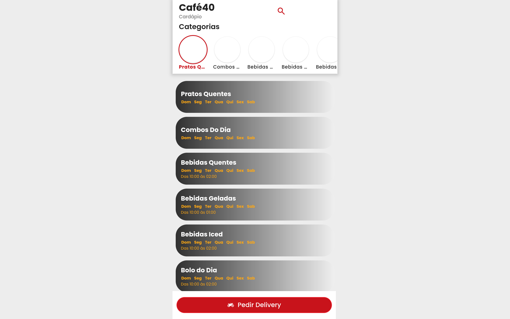

> Nota do projeto: esta extração contém estilos da plataforma de hospedagem. Para a identidade do cliente, consulte assets/design.md na raiz do projeto.

# Cafe40Cardapio DESIGN.md

> Auto-generated design system — reverse-engineered via static analysis by skillui.
> Frameworks: None detected
> Colors: 20 · Fonts: 3 · Components: 0
> Icon library: not detected · State: not detected
> Primary theme: dark · Dark mode toggle: no · Motion: expressive

## Visual Reference

**Match this design exactly** — study colors, fonts, spacing, and component shapes before writing any UI code.



---

## 1. Visual Theme & Atmosphere

This is a **dark-themed** interface with a warm tone. Depth is expressed through layered shadows and subtle surface color variation. Typography pairs **Raleway** for display/headings with **Poppins** for body text, creating clear visual hierarchy through type contrast. Spacing follows a **4px base grid** (compact density), with scale: 2, 4, 6, 8, 10, 12, 16, 20px. The accent color **#ffc107** anchors interactive elements (buttons, links, focus rings). Motion is expressive — spring physics, layout animations, and staggered reveals are part of the visual language.

---

## 2. Color Palette & Roles

| Token | Hex | Role | Use |
|---|---|---|---|
| theme-color | `#000000` | background | Page background, darkest surface |
| surface | `#373b3e` | surface | Card and panel backgrounds |
| bs-table-striped-color | `#ffffff` | text-primary | Headings and body text |
| bs-secondary | `#6c757d` | text-muted | Captions, placeholders, secondary info |
| bs-table-striped-color | `#212529` | border | Dividers, card borders, outlines |
| bs-warning | `#ffc107` | accent | CTAs, links, focus rings, active states |
| bs-danger | `#dc3545` | danger | Error states, destructive actions |
| bs-success | `#198754` | success | Success states, positive indicators |
| warning | `#ffa814` | warning | Warning states, caution indicators |
| bs-primary | `#0d6efd` | info | Informational highlights |
| unknown | `#e9ecef` | unknown | Palette color |
| toastify-spinner-color-empty-area | `#dee2e6` | unknown | Palette color |
| bs-info | `#0dcaf0` | unknown | Palette color |
| unknown | `#0a58ca` | unknown | Palette color |
| toastify-spinner-color | `#5c636a` | unknown | Palette color |
| unknown | `#c8131b` | unknown | Palette color |
| unknown | `#cbccce` | unknown | Palette color |
| unknown | `#51585e` | unknown | Palette color |
| unknown | `#31d2f2` | unknown | Palette color |
| unknown | `#ffca2c` | unknown | Palette color |

### CSS Variable Tokens

```css
--bs-primary: #0d6efd;
--bs-secondary: #6c757d;
--bs-table-accent-bg: transparent;
--bs-table-accent-bg: var(--bs-table-striped-bg);
--bs-table-accent-bg: var(--bs-table-active-bg);
--bs-table-accent-bg: var(--bs-table-hover-bg);
--toastify-toast-background: #fff;
```


---

## 3. Typography Rules

**Font Stack:**
- **Poppins** — Heading 1, Heading 2, Heading 3
- **Raleway** — Body, Caption
- **Consolas** — Code

**Font Sources:**

```css
@font-face {
  font-family: "Raleway";
  src: url("https://fonts.gstatic.com/s/raleway/v37/1Ptxg8zYS_SKggPN4iEgvnHyvveLxVvaooCP.ttf") format("truetype");
  font-weight: 400;
}
@font-face {
  font-family: "Raleway";
  src: url("https://fonts.gstatic.com/s/raleway/v37/1Ptxg8zYS_SKggPN4iEgvnHyvveLxVs9pYCP.ttf") format("truetype");
  font-weight: 700;
}
@font-face {
  font-family: "Poppins";
  src: url("https://fonts.gstatic.com/s/poppins/v24/pxiGyp8kv8JHgFVrJJLedw.ttf") format("truetype");
  font-weight: 400;
}
@font-face {
  font-family: "Poppins";
  src: url("https://fonts.gstatic.com/s/poppins/v24/pxiDyp8kv8JHgFVrJJLmy15lEA.ttf") format("truetype");
  font-weight: 700;
}
```

| Role | Font | Size | Weight |
|---|---|---|---|
| Heading 1 | Poppins | 5rem | 700 |
| Heading 2 | Poppins | 4.5rem | 700 |
| Heading 3 | Poppins | 4rem | 700 |
| Body | Raleway | 1.25rem | 400 |
| Caption | Raleway | .875rem | 400 |
| Code | Consolas | 14px | 400 |

**Typographic Rules:**
- Limit to 3 font families max per screen
- Use **Poppins** for body/UI text, **Raleway** for display/headings
- Maintain consistent hierarchy: no more than 3-4 font sizes per screen
- Headings use bold (600-700), body uses regular (400)
- Line height: 1.5 for body text, 1.2 for headings
- Use color and opacity for secondary hierarchy, not additional font sizes


---

## 4. Component Stylings

No components detected. Scan `src/components/` or `components/` to populate this section.

---

## 5. Layout Principles

- **Base spacing unit:** 4px
- **Spacing scale:** 2, 4, 6, 8, 10, 12, 16, 20, 24, 26, 28, 30
- **Border radius:** .2rem, .25rem, .25em, .3rem, 1rem, 2em, inherit, 4px, 7px 7px 0px 0px, 7px, 12px, 14.5px, 28px, 40px, 50rem, 100%
- **Max content width:** 1399.98px

**Spacing as Meaning:**
| Spacing | Use |
|---|---|
| 4-8px | Tight: related items within a group |
| 12-16px | Medium: between groups |
| 24-32px | Wide: between sections |
| 48px+ | Vast: major section breaks |


---

## 6. Depth & Elevation

### Flat — subtle depth hints

- `0 0 0 1px #fff,0 0 0 .25rem #0d6efd40`
- `inset 0-1px #00000020`
- `rgba(0, 0, 0, 0.12) 0px 0px 2px 0px, rgba(0, 0, 0, 0.14) 0px 1px 2px 0px`

### Raised — cards, buttons, interactive elements

- `0 0 0 .25rem #0d6efd40`
- `0 0 0 .25rem #19875440`
- `0 0 0 .25rem #dc354540`

### Floating — dropdowns, popovers, modals

- `0 0 20px #0003`
- `0 1px 10px #0000001a,0 2px 15px #0000000d`

### Overlay — full-screen overlays, top-level dialogs

- `inset 0 0 0 9999px var(--bs-table-accent-bg)`

### Z-Index Scale

`0, 1, 2, 3, 5, 10, 20, 1000, 1020, 1030, 1040, 1050, 1060, 1070, 1080, 9999, 2147483647`


---

## 7. Animation & Motion

This project uses **expressive motion**. Animations are an integral part of the experience.

### CSS Animations

- `@keyframes progress-bar-stripes`
- `@keyframes spinner-border`
- `@keyframes spinner-grow`
- `@keyframes Toastify__trackProgress`
- `@keyframes Toastify__bounceInRight`
- `@keyframes Toastify__bounceOutRight`
- `@keyframes Toastify__bounceInLeft`
- `@keyframes Toastify__bounceOutLeft`

### Motion Guidelines

- Duration: 150-300ms for micro-interactions, 300-500ms for page transitions
- Easing: `ease-out` for enters, `ease-in` for exits
- Always respect `prefers-reduced-motion`


---

## 8. Do's and Don'ts

### Do's

- Use `#ffc107` for interactive elements (buttons, links, focus rings)
- Use `#000000` as the primary page background
- Pair **Poppins** (body) with **Raleway** (display) — these are the only allowed fonts
- Follow the **4px** spacing grid for all margins, padding, and gaps
- Use the defined shadow tokens for elevation — see Section 6
- Use border-radius from the scale: .2rem, .25rem, .25em, .3rem, 1rem

### Don'ts

- Don't introduce colors outside this palette — extend the design tokens first
- Don't introduce additional font families beyond Poppins and Raleway and Consolas
- Don't use arbitrary spacing values — stick to multiples of 4px
- Don't create custom box-shadow values outside the system tokens
- Don't use arbitrary border-radius values — pick from the defined scale
- Don't use backdrop-blur or blur effects

### Anti-Patterns (detected from codebase)

- No blur or backdrop-blur effects
- No zebra striping on tables/lists


---

## 9. Responsive Behavior

| Name | Value | Source |
|---|---|---|
| xs | 400px | css |
| xs | 480px | css |
| sm | 575.98px | css |
| sm | 576px | css |
| md | 767.98px | css |
| md | 768px | css |
| lg | 991.98px | css |
| lg | 992px | css |
| xl | 1199.98px | css |
| xl | 1200px | css |
| 2xl | 1399.98px | css |
| 2xl | 1400px | css |

**Approach:** Use `@media (min-width: ...)` queries matching the breakpoints above.


---

## 10. Agent Prompt Guide

Use these as starting points when building new UI:

### Build a Card

```
Background: #373b3e
Border: 1px solid #212529
Radius: 7px 7px 0px 0px
Padding: 16px
Font: Poppins
Use shadow tokens from Section 6.
```

### Build a Button

```
Primary: bg #ffc107, text white
Ghost: bg transparent, border #212529
Padding: 8px 16px
Radius: 7px 7px 0px 0px
Hover: opacity 0.9 or lighter shade
Focus: ring with #ffc107
```

### Build a Page Layout

```
Background: #000000
Max-width: 1399.98px, centered
Grid: 4px base
Responsive: mobile-first, breakpoints from Section 9
```

### Build a Stats Card

```
Surface: #373b3e
Label: #6c757d (muted, 12px, uppercase)
Value: #ffffff (primary, 24-32px, bold)
Status: use success/warning/danger from Section 2
```

### Build a Form

```
Input bg: #000000
Input border: 1px solid #212529
Focus: border-color #ffc107
Label: #6c757d 12px
Spacing: 16px between fields
Radius: 7px 7px 0px 0px
```

### General Component

```
1. Read DESIGN.md Sections 2-6 for tokens
2. Colors: only from palette
3. Font: Poppins, type scale from Section 3
4. Spacing: 4px grid
5. Components: match patterns from Section 4
6. Elevation: shadow tokens
```
