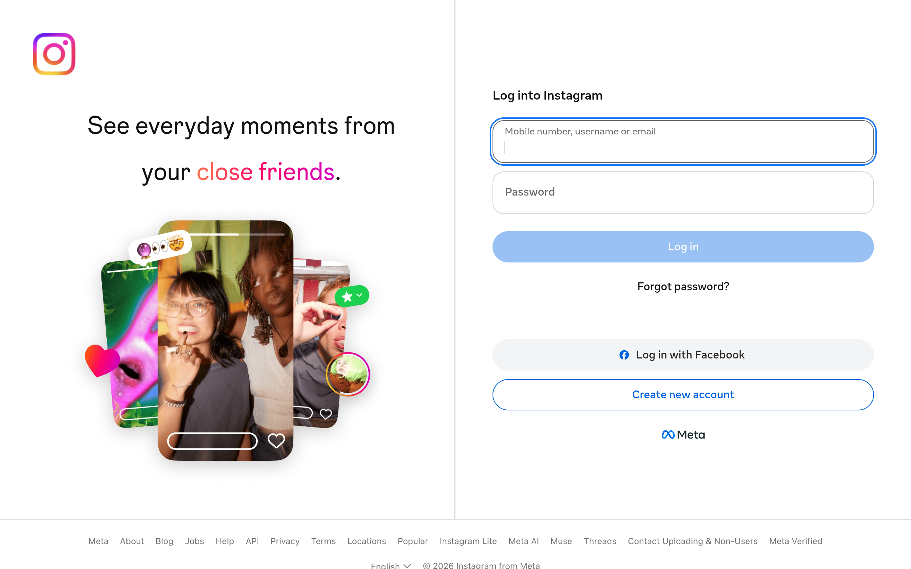

> Nota do projeto: esta extração contém estilos da plataforma de hospedagem. Para a identidade do cliente, consulte assets/design.md na raiz do projeto.

# Cafe40 DESIGN.md

> Auto-generated design system — reverse-engineered via static analysis by skillui.
> Frameworks: None detected
> Colors: 20 · Fonts: 3 · Components: 7
> Icon library: not detected · State: not detected
> Primary theme: light · Dark mode toggle: no · Motion: expressive

## Visual Reference

**Match this design exactly** — study colors, fonts, spacing, and component shapes before writing any UI code.



---

## 1. Visual Theme & Atmosphere

This is a **light-themed** interface with a cool, approachable feel. The light background emphasizes content clarity. Typography pairs **Instagram Sans Condensed** for display/headings with **Instagram Sans Condensed Regular** for body text, creating clear visual hierarchy through type contrast. Spacing follows a **4px base grid** (compact density), with scale: 2, 4, 6, 8, 10, 12, 14, 16px. The palette is predominantly monochromatic with **#0095f6** as the single accent color — used sparingly for interactive elements and emphasis. Motion is expressive — spring physics, layout animations, and staggered reveals are part of the visual language.

---

## 2. Color Palette & Roles

| Token | Hex | Role | Use |
|---|---|---|---|
| theme-color | `#ffffff` | background | Page background, darkest surface |
| media-inner-border | `#000000` | text-primary | Headings and body text |
| switch-unchecked-background-color | `#737373` | text-muted | Captions, placeholders, secondary info |
| primary-icon | `#262626` | border | Dividers, card borders, outlines |
| accent | `#0095f6` | accent | CTAs, links, focus rings, active states |
| info | `#405cff` | info | Informational highlights |
| fds-comment-background | `#f2f2f2` | unknown | Palette color |
| primary-icon | `#e1edf7` | unknown | Palette color |
| focus-ring-blue | `#1877f2` | unknown | Palette color |
| chat-incoming-message-bubble-background-color | `#333333` | unknown | Palette color |
| tooltip-background | `#0c1014` | unknown | Palette color |
| unknown | `#d9d9d9` | unknown | Palette color |
| toast-text | `#1c2b33` | unknown | Palette color |
| unknown | `#543e8f` | unknown | Palette color |
| unknown | `#283943` | unknown | Palette color |
| positive-background | `#e5e5e7` | unknown | Palette color |
| secondary-icon | `#969696` | unknown | Palette color |
| secondary-icon | `#a7b3bf` | unknown | Palette color |
| border-focused | `#65676b` | unknown | Palette color |
| unknown | `#0a78be` | unknown | Palette color |

### CSS Variable Tokens

```css
--fds-comment-background: #F2F3F5;
--fds-highlight-cell-background: #ECF3FF;
--fds-primary-icon: #1C1E21;
--fds-primary-text: #1C1E21;
--accent: #0095F6;
--attachment-footer-background: #F0F2F5;
--background-deemphasized: #F0F2F5;
--badge-background-color-blue: var(--accent);
--badge-background-color-dark-gray: var(--secondary-icon);
--badge-background-color-gray: var(--disabled-icon);
--badge-background-color-green: var(--positive);
--badge-background-color-light-blue: var(--highlight-bg);
--badge-background-color-red: var(--notification-badge);
--badge-background-color-yellow: var(--base-lemon);
--text-badge-info-background: hsl(214,89%,52%);
--text-badge-success-background: #31A24C;
--text-badge-attention-background: hsl(40,89%,52%);
--text-badge-critical-background: #e41e3f;
--border-focused: #65676B;
--card-background: #FFFFFF;
```


---

## 3. Typography Rules

**Font Stack:**
- **Instagram Sans Condensed Regular** — Heading 1, Heading 2, Heading 3
- **Instagram Sans Condensed** — Body, Caption
- **Menlo** — Code

**Font Sources:**

```css
@font-face {
  font-family: "Instagram Sans Condensed";
  src: url("https://static.cdninstagram.com/rsrc.php/yP/r/ei8K5QReonM.woff2") format("woff2");
  font-weight: 400;
}
@font-face {
  font-family: "Instagram Sans Condensed Regular";
  src: url("https://static.cdninstagram.com/rsrc.php/yF/r/OIHqJOkcQqn.woff2") format("woff2");
  font-weight: 400;
}
@font-face {
  font-family: "Optimistic AI VF";
  src: url("https://static.cdninstagram.com/rsrc.php/y4/r/KsNfEF_apC2.woff2") format("woff2");
  font-weight: 300;
}
@font-face {
  font-family: "Instagram Sans";
  src: url("https://static.cdninstagram.com/rsrc.php/y5/r/_a_FWcDLOaW.woff2") format("woff2");
  font-weight: 400;
}
@font-face {
  font-family: "Optimistic Text Light";
  src: url("https://static.cdninstagram.com/rsrc.php/yJ/r/G4CvqQXT71s.woff2") format("woff2");
  font-weight: 300;
}
@font-face {
  font-family: "Optimistic Text Light Swap";
  src: url("https://static.cdninstagram.com/rsrc.php/yJ/r/G4CvqQXT71s.woff2") format("woff2");
  font-weight: 300;
}
@font-face {
  font-family: "Optimistic Text Normal";
  src: url("https://static.cdninstagram.com/rsrc.php/y2/r/6YirsaXqsap.woff2") format("woff2");
  font-weight: 400;
}
@font-face {
  font-family: "Optimistic Text Normal Swap";
  src: url("https://static.cdninstagram.com/rsrc.php/y2/r/6YirsaXqsap.woff2") format("woff2");
  font-weight: 400;
}
@font-face {
  font-family: "Optimistic Text Medium";
  src: url("https://static.cdninstagram.com/rsrc.php/ye/r/ndhgOwkNmDs.woff2") format("woff2");
  font-weight: 500;
}
@font-face {
  font-family: "Optimistic Text Medium Swap";
  src: url("https://static.cdninstagram.com/rsrc.php/ye/r/ndhgOwkNmDs.woff2") format("woff2");
  font-weight: 500;
}
@font-face {
  font-family: "Optimistic Text Bold";
  src: url("https://static.cdninstagram.com/rsrc.php/y8/r/WF8VhTuShVE.woff2") format("woff2");
  font-weight: 700;
}
@font-face {
  font-family: "Optimistic Text Bold Swap";
  src: url("https://static.cdninstagram.com/rsrc.php/y8/r/WF8VhTuShVE.woff2") format("woff2");
  font-weight: 700;
}
@font-face {
  font-family: "Optimistic Text ExtraBold";
  src: url("https://static.cdninstagram.com/rsrc.php/yO/r/_IxD8PqgShI.woff2") format("woff2");
  font-weight: 800;
}
@font-face {
  font-family: "Optimistic Text ExtraBold Swap";
  src: url("https://static.cdninstagram.com/rsrc.php/yO/r/_IxD8PqgShI.woff2") format("woff2");
  font-weight: 800;
}
@font-face {
  font-family: "Optimistic Text Viet Light";
  src: url("https://static.cdninstagram.com/rsrc.php/ye/r/KjRMIwI5MLI.woff2") format("woff2");
  font-weight: 300;
}
@font-face {
  font-family: "Optimistic Text Viet Light Swap";
  src: url("https://static.cdninstagram.com/rsrc.php/ye/r/KjRMIwI5MLI.woff2") format("woff2");
  font-weight: 300;
}
@font-face {
  font-family: "Optimistic Text Viet Normal";
  src: url("https://static.cdninstagram.com/rsrc.php/yT/r/577bYCjitsm.woff2") format("woff2");
  font-weight: 400;
}
@font-face {
  font-family: "Optimistic Text Viet Normal Swap";
  src: url("https://static.cdninstagram.com/rsrc.php/yT/r/577bYCjitsm.woff2") format("woff2");
  font-weight: 400;
}
@font-face {
  font-family: "Optimistic Text Viet Bold";
  src: url("https://static.cdninstagram.com/rsrc.php/yQ/r/6sGd9jAF7-G.woff2") format("woff2");
  font-weight: 700;
}
@font-face {
  font-family: "Optimistic Text Viet Bold Swap";
  src: url("https://static.cdninstagram.com/rsrc.php/yQ/r/6sGd9jAF7-G.woff2") format("woff2");
  font-weight: 700;
}
@font-face {
  font-family: "Optimistic Text Arbc Light";
  src: url("https://static.cdninstagram.com/rsrc.php/yv/r/1lvRwR8FCtJ.woff2") format("woff2");
  font-weight: 300;
}
@font-face {
  font-family: "Optimistic Text Arbc Light Swap";
  src: url("https://static.cdninstagram.com/rsrc.php/yv/r/1lvRwR8FCtJ.woff2") format("woff2");
  font-weight: 300;
}
@font-face {
  font-family: "Optimistic Text Arbc Normal";
  src: url("https://static.cdninstagram.com/rsrc.php/yV/r/KandUw__L2Y.woff2") format("woff2");
  font-weight: 400;
}
@font-face {
  font-family: "Optimistic Text Arbc Normal Swap";
  src: url("https://static.cdninstagram.com/rsrc.php/yV/r/KandUw__L2Y.woff2") format("woff2");
  font-weight: 400;
}
@font-face {
  font-family: "Optimistic Text Arbc Bold";
  src: url("https://static.cdninstagram.com/rsrc.php/y2/r/Y5UW-giPmlu.woff2") format("woff2");
  font-weight: 700;
}
@font-face {
  font-family: "Optimistic Text Arbc Bold Swap";
  src: url("https://static.cdninstagram.com/rsrc.php/y2/r/Y5UW-giPmlu.woff2") format("woff2");
  font-weight: 700;
}
@font-face {
  font-family: "Optimistic Display Light";
  src: url("https://static.cdninstagram.com/rsrc.php/y7/r/7IYPg3-s_Dn.woff2") format("woff2");
  font-weight: 300;
}
@font-face {
  font-family: "Optimistic Display Light Swap";
  src: url("https://static.cdninstagram.com/rsrc.php/y7/r/7IYPg3-s_Dn.woff2") format("woff2");
  font-weight: 300;
}
@font-face {
  font-family: "Optimistic Display Medium";
  src: url("https://static.cdninstagram.com/rsrc.php/yL/r/jfwoHaS3i0K.woff2") format("woff2");
  font-weight: 500;
}
@font-face {
  font-family: "Optimistic Display Medium Swap";
  src: url("https://static.cdninstagram.com/rsrc.php/yL/r/jfwoHaS3i0K.woff2") format("woff2");
  font-weight: 500;
}
@font-face {
  font-family: "Optimistic Display Semibold";
  src: url("https://static.cdninstagram.com/rsrc.php/yo/r/n0aIRIy9q6Y.woff2") format("woff2");
  font-weight: 600;
}
@font-face {
  font-family: "Optimistic Display Semibold Swap";
  src: url("https://static.cdninstagram.com/rsrc.php/yo/r/n0aIRIy9q6Y.woff2") format("woff2");
  font-weight: 600;
}
@font-face {
  font-family: "Optimistic Display Bold";
  src: url("https://static.cdninstagram.com/rsrc.php/yU/r/WXBYOaYZuYu.woff2") format("woff2");
  font-weight: 700;
}
@font-face {
  font-family: "Optimistic Display Bold Swap";
  src: url("https://static.cdninstagram.com/rsrc.php/yU/r/WXBYOaYZuYu.woff2") format("woff2");
  font-weight: 700;
}
@font-face {
  font-family: "Optimistic Display Viet Light";
  src: url("https://static.cdninstagram.com/rsrc.php/ye/r/NgfGZAAbez9.woff2") format("woff2");
  font-weight: 300;
}
@font-face {
  font-family: "Optimistic Display Viet Light Swap";
  src: url("https://static.cdninstagram.com/rsrc.php/ye/r/NgfGZAAbez9.woff2") format("woff2");
  font-weight: 300;
}
@font-face {
  font-family: "Optimistic Display Viet Medium";
  src: url("https://static.cdninstagram.com/rsrc.php/y0/r/4ozoJwSmcc3.woff2") format("woff2");
  font-weight: 500;
}
@font-face {
  font-family: "Optimistic Display Viet Medium Swap";
  src: url("https://static.cdninstagram.com/rsrc.php/y0/r/4ozoJwSmcc3.woff2") format("woff2");
  font-weight: 500;
}
@font-face {
  font-family: "Optimistic Display Viet Bold";
  src: url("https://static.cdninstagram.com/rsrc.php/yw/r/CrNHpFjZLUv.woff2") format("woff2");
  font-weight: 700;
}
@font-face {
  font-family: "Optimistic Display Viet Bold Swap";
  src: url("https://static.cdninstagram.com/rsrc.php/yw/r/CrNHpFjZLUv.woff2") format("woff2");
  font-weight: 700;
}
@font-face {
  font-family: "Optimistic Display Arbc Light";
  src: url("https://static.cdninstagram.com/rsrc.php/yl/r/ACM78BvaEDZ.woff2") format("woff2");
  font-weight: 300;
}
@font-face {
  font-family: "Optimistic Display Arbc Light Swap";
  src: url("https://static.cdninstagram.com/rsrc.php/yl/r/ACM78BvaEDZ.woff2") format("woff2");
  font-weight: 300;
}
@font-face {
  font-family: "Optimistic Display Arbc Medium";
  src: url("https://static.cdninstagram.com/rsrc.php/yd/r/icTeuzc84q0.woff2") format("woff2");
  font-weight: 500;
}
@font-face {
  font-family: "Optimistic Display Arbc Medium Swap";
  src: url("https://static.cdninstagram.com/rsrc.php/yd/r/icTeuzc84q0.woff2") format("woff2");
  font-weight: 500;
}
@font-face {
  font-family: "Optimistic Display Arbc Bold";
  src: url("https://static.cdninstagram.com/rsrc.php/yb/r/SRqN16ICttb.woff2") format("woff2");
  font-weight: 700;
}
@font-face {
  font-family: "Optimistic Display Arbc Bold Swap";
  src: url("https://static.cdninstagram.com/rsrc.php/yb/r/SRqN16ICttb.woff2") format("woff2");
  font-weight: 700;
}
@font-face {
  font-family: "Optimistic";
  src: url("https://static.cdninstagram.com/rsrc.php/yR/r/YC5jVdk8D9S.woff2") format("woff2");
  font-weight: 400;
}
@font-face {
  font-family: "Optimistic";
  src: url("https://static.cdninstagram.com/rsrc.php/yu/r/HdqPnvQ5eKw.woff2") format("woff2");
  font-weight: 700;
}
@font-face {
  font-family: "Optimistic DM";
  src: url("https://static.cdninstagram.com/rsrc.php/ya/r/KGZqgvOAQ9m.woff2") format("woff2");
  font-weight: 400;
}
@font-face {
  font-family: "Optimistic DM";
  src: url("https://static.cdninstagram.com/rsrc.php/y9/r/t398Qu7MEeH.woff2") format("woff2");
  font-weight: 700;
}
@font-face {
  font-family: "Optimistic 95";
  src: url("https://static.cdninstagram.com/rsrc.php/yR/r/YC5jVdk8D9S.woff2") format("woff2");
  font-weight: 400;
}
@font-face {
  font-family: "Optimistic 95";
  src: url("https://static.cdninstagram.com/rsrc.php/yu/r/HdqPnvQ5eKw.woff2") format("woff2");
  font-weight: 700;
}
@font-face {
  font-family: "Instagram Sans Regular";
  src: url("https://static.cdninstagram.com/rsrc.php/y9/r/1GOXakOP6QP.woff2") format("woff2");
  font-weight: 400;
}
@font-face {
  font-family: "Instagram Sans Bold";
  src: url("https://static.cdninstagram.com/rsrc.php/yn/r/St8jE4kAoWJ.woff2") format("woff2");
  font-weight: 700;
}
```

| Role | Font | Size | Weight |
|---|---|---|---|
| Heading 1 | Instagram Sans Condensed Regular | 7.8125rem | 700 |
| Heading 2 | Instagram Sans Condensed Regular | 7.5rem | 700 |
| Heading 3 | Instagram Sans Condensed Regular | 7.0625rem | 700 |
| Body | Instagram Sans Condensed | 1rem | 400 |
| Caption | Instagram Sans Condensed | .75rem | 400 |
| Code | Menlo | 14px | 400 |

**Typographic Rules:**
- Limit to 3 font families max per screen
- Use **Instagram Sans Condensed Regular** for body/UI text, **Instagram Sans Condensed** for display/headings
- Maintain consistent hierarchy: no more than 3-4 font sizes per screen
- Headings use bold (600-700), body uses regular (400)
- Line height: 1.5 for body text, 1.2 for headings
- Use color and opacity for secondary hierarchy, not additional font sizes


---

## 4. Component Stylings

### Layout (1)

**Footer** — `html`

### Navigation (1)

**Navigation** — `html`

### Data Display (1)

**Badge** — `html`

### Data Input (1)

**Input** — `html`
- State: :focus, :placeholder

### Media (3)

**Image** — `html`

**Icon** — `html`

**Map/Canvas** — `html`


---

## 5. Layout Principles

- **Base spacing unit:** 4px
- **Spacing scale:** 2, 4, 6, 8, 10, 12, 14, 16, 18, 20, 22, 24
- **Border radius:** 1px, 1.5px, 2px, 3px, 3.5px, 4px, 5px, 5%, 6px, 7px, 7.25px, 8px, 9px, 10px, 11px, 11.5px, 12px, 14px, 15px, 16px, 17px, 18px, 20px, 21px, 22px, 24px, 25px, 26px, 28px, 30px, 30%, 32px, 33px, 34px, 37px, 38px, 40px, 44px, 48px, 50vh, 50px, 56px, 60px, 64px, 68px, 70px, 80px, 96px, 99px, 100px, 100vh, 100%, 999px, 1000px, initial, inherit, unset, 200px
- **Max content width:** 975px

**Spacing as Meaning:**
| Spacing | Use |
|---|---|
| 4-8px | Tight: related items within a group |
| 12-16px | Medium: between groups |
| 24-32px | Wide: between sections |
| 48px+ | Vast: major section breaks |


---

## 6. Depth & Elevation

### Flat — subtle depth hints

- `0 0 0 2px #ff9e9e`
- `0 0 0 1px var(--shadow-1)`
- `0 0 0 1px rgb(var(--web-always-black))`

### Raised — cards, buttons, interactive elements

- `0 0 8px 2px #63788a,0 0 1px #63788a`
- `0 0 0 4px #d0e6f4`
- `0 0 8px 2px #4dbba6,0 0 1px #4dbba6`

### Floating — dropdowns, popovers, modals

- `0 0 0 4px #2d2369,0 0 0 12px #5c3bbf33`
- `0 0 0 4px #341c63,0 0 0 12px #f0ebf5`
- `0 0 0 4px #7373be,0 0 0 12px #5c3bbf33`

### Overlay — full-screen overlays, top-level dialogs

- `0 12px 28px 0 var(--shadow-2),0 2px 4px 0 var(--shadow-1),inset 0 0 0 1px var(--shadow-inset)`
- `0 2px 16px #0b10141a,0 4px 40px #0b10141a`
- `0 12px 28px 0 var(--shadow-2),0 2px 4px 0 var(--shadow-2)`

### Z-Index Scale

`0, 1, 2, 3, 4, 5, 6, 8, 9, 10, 11, 12, 15, 20, 30, 50, 98, 99, 100, 101, 200, 201, 202, 203, 400, 401, 402, 500, 502, 777, 999, 1000, 1001, 1002, 2000, 9001, 9998, 9999, 10000, 2147483647`


---

## 7. Animation & Motion

This project uses **expressive motion**. Animations are an integral part of the experience.

### CSS Animations

- `@keyframes x10fmoen-B`
- `@keyframes x10tv6ar-B`
- `@keyframes x122imku-B`
- `@keyframes x127erq4-B`
- `@keyframes x12cjf5l-B`
- `@keyframes x12ve19h-B`
- `@keyframes x1397pin-B`
- `@keyframes x13sqfrp-B`

### Motion Guidelines

- Duration: 150-300ms for micro-interactions, 300-500ms for page transitions
- Easing: `ease-out` for enters, `ease-in` for exits
- Always respect `prefers-reduced-motion`


---

## 8. Do's and Don'ts

### Do's

- Use `#0095f6` for interactive elements (buttons, links, focus rings)
- Use `#ffffff` as the primary page background
- Pair **Instagram Sans Condensed Regular** (body) with **Instagram Sans Condensed** (display) — these are the only allowed fonts
- Follow the **4px** spacing grid for all margins, padding, and gaps
- Use the defined shadow tokens for elevation — see Section 6
- Use border-radius from the scale: 1px, 1.5px, 2px, 3px, 3.5px
- Reuse existing components from Section 4 before creating new ones

### Don'ts

- Don't introduce colors outside this palette — extend the design tokens first
- Don't introduce additional font families beyond Instagram Sans Condensed Regular and Instagram Sans Condensed and Menlo
- Don't use arbitrary spacing values — stick to multiples of 4px
- Don't create custom box-shadow values outside the system tokens
- Don't use arbitrary border-radius values — pick from the defined scale
- Don't duplicate component patterns — check Section 4 first
- Don't use backdrop-blur or blur effects

### Anti-Patterns (detected from codebase)

- No blur or backdrop-blur effects
- No zebra striping on tables/lists


---

## 9. Responsive Behavior

| Name | Value | Source |
|---|---|---|
| xs | 375px | css |
| xs | 400px | css |
| xs | 447px | css |
| xs | 450px | css |
| xs | 459px | css |
| xs | 460px | css |
| xs | 480px | css |
| sm | 500px | css |
| sm | 519px | css |
| sm | 564px | css |
| sm | 600px | css |
| sm | 622px | css |
| sm | 639px | css |
| sm | 640px | css |
| md | 645px | css |
| md | 655px | css |
| md | 679px | css |
| md | 680px | css |
| md | 735px | css |
| md | 736px | css |
| md | 767px | css |
| md | 768px | css |
| lg | 800px | css |
| lg | 801px | css |
| lg | 856px | css |
| lg | 857px | css |
| lg | 875px | css |
| lg | 876px | css |
| lg | 880px | css |
| lg | 899px | css |
| lg | 900px | css |
| lg | 901px | css |
| lg | 905px | css |
| lg | 912px | css |
| lg | 913px | css |
| lg | 945px | css |
| lg | 960px | css |
| lg | 968px | css |
| lg | 969px | css |
| lg | 970px | css |
| lg | 980px | css |
| lg | 990px | css |
| lg | 999px | css |
| lg | 1000px | css |
| lg | 1024px | css |
| xl | 1025px | css |
| xl | 1088px | css |
| xl | 1089px | css |
| xl | 1099px | css |
| xl | 1100px | css |
| xl | 1152px | css |
| xl | 1153px | css |
| xl | 1160px | css |
| xl | 1200px | css |
| xl | 1201px | css |
| xl | 1216px | css |
| xl | 1263px | css |
| xl | 1264px | css |
| 2xl | 1300px | css |
| 2xl | 1301px | css |
| 2xl | 1384px | css |
| 2xl | 1400px | css |
| 2xl | 1439px | css |
| 2xl | 1440px | css |
| 2xl | 1730px | css |
| 2xl | 1800px | css |
| 2xl | 1919px | css |
| 2xl | 1920px | css |
| 2xl | 1921px | css |
| 2xl | 1928px | css |
| 2xl | 2076px | css |
| 2xl | 9999px | css |

**Approach:** Use `@media (min-width: ...)` queries matching the breakpoints above.


---

## 10. Agent Prompt Guide

Use these as starting points when building new UI:

### Build a Card

```
Background: #ffffff
Border: 1px solid #262626
Radius: 30px
Padding: 16px
Font: Instagram Sans Condensed Regular
Use shadow tokens from Section 6.
```

### Build a Button

```
Primary: bg #0095f6, text white
Ghost: bg transparent, border #262626
Padding: 8px 16px
Radius: 30px
Hover: opacity 0.9 or lighter shade
Focus: ring with #0095f6
```

### Build a Page Layout

```
Background: #ffffff
Max-width: 975px, centered
Grid: 4px base
Responsive: mobile-first, breakpoints from Section 9
```

### Build a Stats Card

```
Surface: #ffffff
Label: #737373 (muted, 12px, uppercase)
Value: #000000 (primary, 24-32px, bold)
Status: use success/warning/danger from Section 2
```

### Build a Form

```
Input bg: #ffffff
Input border: 1px solid #262626
Focus: border-color #0095f6
Label: #737373 12px
Spacing: 16px between fields
Radius: 30px
```

### General Component

```
1. Read DESIGN.md Sections 2-6 for tokens
2. Colors: only from palette
3. Font: Instagram Sans Condensed Regular, type scale from Section 3
4. Spacing: 4px grid
5. Components: match patterns from Section 4
6. Elevation: shadow tokens
```
